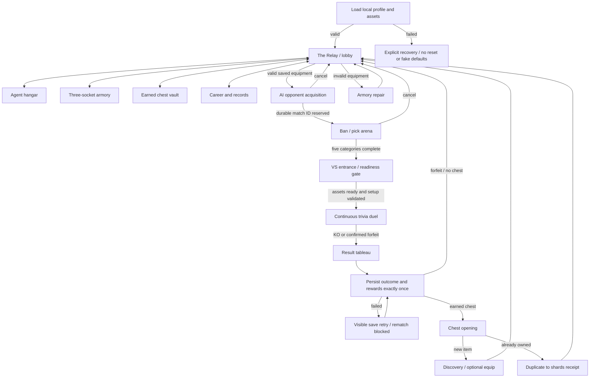

# BRAIN BRAWL / THE RELAY

## Ground-up game experience proposal

**Status: design proposal, not an implemented or approved redesign.**
This supersedes the earlier website-like VOLT screen structure. Existing code
and generated character images are working prototypes, not final design evidence.
VOLT's electric palette can survive; its generic page composition should not.

Companion: [visual composition board](GAME_EXPERIENCE_BOARD.html).
The board is a design document with six fixed-screen studies, not production UI.

## 1. The actual change

Brain Brawl should feel like entering a competitive world, preparing a human
agent, and stepping into a knowledge-powered duel. It should not feel like
completing a setup wizard or browsing a dashboard.

| Retire | Replace with |
| --- | --- |
| Page title, explanatory paragraph, cards, full-width CTA | An immersive scene with a few anchored game controls |
| Generic Arena/Profile application tabs | Five recognizable game destinations: Arena, Agents, Armory, Vault, Career |
| A route for every configuration step | Persistent preparation plus a short match-entry sequence |
| Repeated Back / Arena / Profile button rows | An edge-mounted back chevron, context controls, and consistent navigation |
| Previous section / Next section through an entire screen | Direct spatial selection, named sub-tabs, portrait rails and object inspection |
| Character image inside a card | Character as the central object in the world |
| Rectangular booster checkboxes | Three physical power sockets with one-for-one replacement |
| Text-only reward receipt | Earned chest, opening, discovery, duplicate settlement, equip decision |
| Generic icon pack with interchangeable line art | Original, related navigation, ability, resource and progression glyphs |
| Cosmetic ranks and notification dots | Truthful progress and actionable, persistent state |

**Icon-led does not mean cryptic.** Important icons have short labels;
irreversible actions have explicit confirmation. Answers remain readable text.
The references themselves use START and PLAY: the difference is their role,
material, placement and feedback, not removing every word from a control.

## 2. World and creative direction

### The Relay

An underground broadcast arena where knowledge is converted into energy.
The player belongs to a roster of human specialists competing inside a
monumental signal reactor. This is the game's setting, not a new game mechanic.

- **Lobby:** an architectural hangar overlooking a red reactor and distant city.
  The selected agent is a full-body foreground presence, not a thumbnail.
- **Agents:** the same world from the roster gallery; portrait banners and
  personal emblems make each agent collectible and recognizable.
- **Armory:** a luminous preparation console. Powers are devices inserted into
  three sockets, not items in a settings list.
- **Battle:** a restrained arena silhouette, opposing agents, readable question
  field and high-contrast hit effects. Reading comes before spectacle.
- **Vault:** a darker extraction chamber where a single hinged chest becomes the
  center of attention.

Use depth: foreground framing, character, mid-ground light, background
architecture. A flat red rectangle with a character pasted on it is not the world.

### Visual rules

Ink and chalk establish clarity; signal red establishes arena energy; acid yellow
marks selected/armed/actionable objects. Cyan/violet can identify elemental
effects and rarity, but not compete with every navigation control.

Typography has three jobs: condensed display for event moments, compact labels
for systems, and unstyled readable question text. No giant page heading on every
screen. Character names, victory and discovery earn oversized typography.

Human art must have mature anatomy, distinct faces, grounded poses, textured
painted shading and original clothing. The current six illustrations are
concept candidates, not a finished production animation set.

## 3. Experience architecture

### Persistent destinations

| Destination | Player intent | Entry / exit model |
| --- | --- | --- |
| Arena | See my agent, readiness and next match | Default return destination |
| Agents | Inspect, collect and equip a character | Fixed gallery; inspect without equipping |
| Armory | Replace one of my three powers | Tap socket, choose replacement, persist valid kit |
| Vault | Open earned chests; inspect collection | Only real pending rewards receive a badge |
| Career | See real progression, records and mastery | Direct Progress / Record / Milestones sub-tabs |

Settings is a top-edge gear, not a main destination. Identity is an inspectable
player emblem. Mode is a compact lobby selector, not a mandatory landing page.
Only AI Duel is playable now: do not create fake online parties, friend lists,
ranked queues, store offers or a battle pass to make the screen look populated.

### Three navigation layers

1. **World navigation:** five icons plus short labels, persistent in lobby,
   collection and preparation spaces.
2. **Inspection:** one sheet/overlay or dedicated close-up scene; close/back
   returns to the exact prior selection.
3. **Match:** queue, draft, entrance, battle and reward rituals own the screen.
   The battle dock replaces world navigation. Forfeit is never a casual home tap.

Avoid nested modal stacks. One inspection and, when needed, one confirmation.

### Revised main loop

**Returning player path:** one deployment action, two deliberate draft decisions,
then battle. No routine mode confirmation, fighter confirmation, loadout form
and Continue chain when the saved equipment is already valid.

## 4. Screen-by-screen direction

### 00 / Arrival and recovery

Boot is an arena insignia and real asset/profile readiness, not a fake loading
percentage. First-time arrival briefly introduces the owned starter and the
knowledge-combat premise; it is skippable and not repeated on every launch.
Do not grant extra characters or currencies through onboarding without a rule
change. Failed storage loads show recovery, never a new blank player.

### 01 / Lobby: the world is the home screen

- Compact player emblem/level at the upper left; real currencies and gear at
  the upper right. No dashboard header or explanatory paragraph.
- Human agent occupies the central stage. Tapping the body/name inspects the
  agent. A subtle selection pedestal establishes ownership and readiness.
- The three equipped powers are small but inspectable objects near the stage.
- A compact AI Duel selector sits above a dedicated angular deployment module.
  Deployment uses an original duel sigil, short label and framed press feedback;
  it is not a full-width marketing CTA.
- An earned chest can appear as a world object when one is actually pending.
  Contracts/milestones only appear when backed by real progress.
- Five navigation sigils anchor the bottom. The active destination receives
  material/shape emphasis, not just a colored website tab label.

At 360 x 640, remove secondary promotional content before shrinking the primary
controls. Preserve the agent, kit, deployment and navigation. At 320 x 568,
reduce decorative stage depth and use inspection for details, not clipped text.

### 02 / Agent hangar

Large selected human, name treatment, personal emblem and passive state.
Six portrait banners form a directly selectable rail or compact fixed gallery.
Owned, selected, equipped and locked are different states.

Inspecting a locked agent shows their real passive, rarity and acquisition
source. It does not silently select them or offer a nonfunctional unlock CTA.
The equip seal persists only an owned selection; failure leaves the prior
equipment authoritative and the error visible. Closing inspection discards an
unconfirmed selection.

Collection rarity is not combat strength. No invented attack/defense stat bars.

### 03 / Armory: interaction, not a checkbox form

Three large power sockets define the screen. Tap a socket to select it, then
tap an owned compatible power to preview/replace that slot. Dragging may be an
optional enhancement, never the only way to equip.

An ordinary replacement remains one-for-one, preserving a valid three-power
kit. Duplicate powers cannot occupy multiple sockets. A legacy incompatible
power becomes a clearly marked repair slot. Inspecting powers explains effects
without changing equipment.

Commit each valid replacement atomically. Show a socket-level saving state;
on failure retain/revert to the last saved kit and offer retry. Do not navigate
into battle on an unsaved optimistic selection.

### 04 / Opponent acquisition

A player banner and an AI opponent banner occupy the scene. The selected
agent/powers remain visible as locked preparation. Cancel is an edge-mounted
control, not a second primary CTA.

The existing local search remains clearly AI, cancellable and deterministic.
Do not fake human presence, connection bars or server latency. Transition only
after a unique match ID has been durably reserved.

### 05 / Category draft arena

Eight original category sigils on a fixed tactical board, with readable short
names. Selected category expands a concise inspection caption.

The same scene changes from **BAN ONE** to **PICK ONE**. A ban uses a red
exclusion treatment; a pick uses an affirmative selection treatment. Confirm
with a contextual stamp, not a generic Continue button. Show the AI response
and the final five category crests in place.

The engine order stays player ban, AI ban, player pick, AI pick, system fill.
There is no invented draft countdown and no category-round structure.

### 06 / VS entrance

Two human banners, the five category crests and a short arena entrance motion.
This is the emotional bridge into combat, not another confirmation screen.
Validate equipment, finalized setup and required assets before starting the
actual battle clock. A short introduction is skippable; reduced motion uses a
static versus composition. A real failure offers retry or a safe return.

### 07 / Duel

Top corners: player/opponent identity and HP. Upper arena: a painted side-on
setting, one shared platform, contact shadows and opposing articulated humans.
Center: the shared question and my timer. Lower field: four
answer slabs in a 2 x 2 grid. Bottom: exactly three equipped ability sigils.

The timer is my deadline, not a fabricated shared clock. Enemy lock state is
public; enemy answer correctness remains hidden until both players finish.
Selecting an answer locks it independently and gives immediate, calm feedback.

Ability states: ready, temporarily unavailable, used, and used-but-armed.
Shape, ring treatment and a short label accompany color. A used armed shield
must not look like a power that failed to activate.

During reading, motion recedes. During resolution, real attacks, blocks,
passives, damage and combo events drive the spectacle. Never invent a hit to
make the animation exciting. There are no rounds, clash turns or sudden death.

Resolution expands the fight region while inactive answers fold into a concise
correct-answer strip. Punches move shoulders/elbows/wrists; power kicks chamber
and extend hips/knees/ankles. Feet belong on the shared floor, not separate
pedestals. Contact-timed STRIKE, BLOCK and KO use dedicated action lettering.
The implemented faceted rig and motion proof are documented in
[combat and chests](COMBAT_AND_CHESTS.md); final painterly animation polish is
still a separate art-production step.

World navigation is absent. Match controls expose Keep playing / Forfeit, with
explicit confirmation. Do not label this overlay PAUSED: the current timer
continues while the player decides.

### 08 / Result tableau

Characters and a single dominant Victory/Defeat treatment establish the outcome.
One readable summary shows real damage score, accuracy and best combo. Tapping
a compact record glyph inspects deeper statistics; do not force five pages of
receipts between the fight and reward.

XP/coin animation represents an already-authoritative saved reward, not a
second grant. A saving failure is a blocking recovery state; no success-shaped
celebration or rematch can discard the unsaved result.

A non-forfeit loss still gets its existing reward and chest. Forfeit gets
no XP, coins or chest. Do not use victory art for a loss.

### 09 / Chest opening and discovery

The hinged chest is the interactive object. Tap its latch: chamber lights converge,
the lid opens, rarity is expressed by light AND frame/sigil, then the actual
item resolves. No repeated website-like Open / Continue / Continue sequence.

- **New agent:** full discovery art, name, rarity and passive; optional equip
  seal, with Keep current as a clear alternative.
- **New power:** enlarged power emblem and concise effect; inspect in Armory.
- **Duplicate:** actual item visibly converts into the actual shard amount.
- **Already opened:** settled receipt, never another opening/grant.
- **Save failure:** visible retry, with the reveal not represented as settled.

The outcome is predetermined by the existing seeded reward record; animation
must not pretend the user can time the tap to change rarity. Normal reveal is
short and can be accelerated; reduced motion resolves immediately. Leaving
before opening preserves the pending chest in Vault.

Four physical container designs are Field (graphite/red straps), Arc
(ivory/violet arch lid), Overdrive (industrial red/acid rails) and Sovereign
(obsidian/gold/ruby). These are cosmetic families, not four new rarity tiers.
Closed/open illustrations exist for all four; segmented hinge animation still
requires a matched lid/base asset pass. Existing internal capsule storage names
are retained for compatibility, not exposed as the new visual direction.

### 10 / Career and milestones

Career emphasizes account progress, owned roster, real records and per-agent
usage. Direct named sub-tabs replace generic document pagination.

Use permanent achievement-style milestones before daily chores: first completed
duel, first win, owned-agent collection and real combo accomplishments.
Derived progress can use existing saved records. Claimable rewards require a
new durable claim ledger and an approved reward budget; they are not fabricated
from the current demo missions.

Do not present Bronze II demo data as a real competitive ladder. No login
punishment, fake urgency or expiring-reward pressure is required for engagement.

## 5. Original iconography system

Build an authored family, not a reskinned generic icon library and not traced
reference glyphs. The board contains initial silhouette studies, not final icons.

- A 32-unit construction grid; bold readable silhouettes, chamfered cuts,
  consistent negative space and a shared central-diamond motif.
- 24 px utility, 28-32 px navigation, 40-48 px abilities, 64 px reward/emblem.
- At least 48 px touch targets, even when the visible glyph is smaller.
- Navigation uses restrained fills; selected states add a structural notch or
  ring. Rarity and ability states must remain identifiable without color.
- Small labels remain for destinations and new/ambiguous systems. Accessible
  names, keyboard focus and desktop tooltips are part of the component contract.

| Family | Required original glyphs |
| --- | --- |
| Core / 16 | Arena, Agents, Armory, Vault, Career, Settings, Back, Close, Equip, Deploy, Queue, Ban, Pick, Coin, Shard, Info |
| Categories / 8 | Science, Sports, History, Movies & TV, Space, Technology, Geography, Music |
| Compatible powers / 5 | 50:50, Extra Time, Double Damage, Mind Shield, Streak Saver |
| Collection rarity / 3 | Common, Rare, Epic frame/sigil treatments |
| Shared states / 4 | Locked, new/unseen, saving, settled |

Second Chance remains a legacy incompatible collectible, not a sixth active
battle ability. Personal agent emblems and career achievements are separate from
rarity; they must not imply different combat power.

## 6. Gamification without inventing an economy

### Preserve now

- Six fighters and existing passives; owned equipment and exactly three
  distinct compatible powers.
- 100 starting HP, independent 12-second questions, current speed/passive
  damage, knockout/forfeit endings and real combo behavior.
- Existing win/loss XP and coins, correct-answer XP, one chest per completed
  non-forfeit match, duplicate conversion and idempotent settlement.
- Current chest rarity odds: common 70%, rare 25%, epic 5%. These are
  **rarity odds**, not equal per-agent odds.
- Duplicate conversion: common 5, rare 15, epic 40 shards.

### Proposed, not approved mechanics

Permanent contracts, cosmetic agent mastery, milestone badges, targeted shard
redemption and a guaranteed-unlock/pity rule are candidates, not implemented
promises. Each needs an explicit rule, migration/claim model, probability or
cost specification and balancing approval before becoming interactive.

Coins currently have no new approved sink. Do not invent a store or paid pulls
to justify their presence. No real-money gacha, deceptive near misses or
unspecified odds are part of this proposal.

## 7. States are the product

| System | Required states and recoveries |
| --- | --- |
| Boot | Reading, asset readiness, ready, storage failure, unsupported data |
| Lobby | Ready, incompatible kit, saving equipment, unsaved result gate |
| Agent | Inspecting, owned, locked, selected, equipped, saving, failed save |
| Armory | Socket focus, compatible preview, duplicate prevention, repair, committing, failed commit |
| Queue | Searching, cancelling, cancelled, reserving ID, found, reservation failure |
| Draft | Ban preview/commit, AI ban, pick preview/commit, AI pick, fill, complete, invalid/direct entry |
| Entrance | Asset readiness, setup validation, ready, retryable failure, cancelled |
| Battle | Answering, locked/waiting, timeout, reveal, passive/ability states, KO, forfeit confirmation |
| Result | Outcome known, save pending, save failed, saved, rematch enabled |
| Chest | Pending, unopened, opening, new, duplicate, settling, failed settlement, already opened |
| Navigation | Direct-entry recovery, Android Back, foreground/background, restored local history |

Every icon's disabled/locked/loading state needs a reason and a route to
resolution. Never silently ignore a tap. Navigation effects and animations do
not become a second source of truth for game state.

## 8. Composition and motion specification

Portrait-first mobile is the baseline; tablet/desktop recomposes the world
around a larger central stage, rather than stretching a mobile card layout.
Phone landscape gets a compact scene arrangement; it is not a shrunken portrait.

- **Mobile:** status at the top, character/interaction stage in the middle,
  context actions above the five-icon navigation. Protect safe areas.
- **Desktop:** a side or top navigation rail, wider scene, utilities at the
  edges, deployment anchored lower right. No empty promotional sidebars.
- **Short screens:** remove flavor text and decorative panels, scale the stage,
  and preserve direct inspection. Never create document scrolling or hide
  required controls behind overflow.
- **Large text:** essential body/answer text remains readable; recompose and
  reduce simultaneous secondary information. Text clipping or global font
  shrinking is not an accessibility strategy.

| Motion | Intent / provisional duration |
| --- | --- |
| Press | Immediate material compression/edge response, 70-110 ms |
| Selection | Focus ring/socket engagement, 120-180 ms |
| World destination | Short camera/light transition, 180-280 ms |
| Draft commitment | Crest lock/break, 250-400 ms; never a fake countdown |
| VS entrance | Brief 600-1000 ms bridge, skippable; readiness before battle clock |
| Battle | Existing contact/reveal timing remains authoritative |
| Result | Outcome, then real summary, then reward object; tap can accelerate |
| Chest | Roughly 1.5-2 s normal opening; immediate reduced-motion result |

Durations are design targets, not a reason to block saving, input readiness or
the current battle engine. Ambient motion must be sparse; no perpetual bouncing
controls, flashing attention traps or fake loading progress.

For production character motion, commission/export layered human anatomy or
authored pose sets: idle, anticipation/contact/recovery, block, recoil, fall,
special, victory. Scaling one PNG is a prototype, not a finished combat rig.

## 9. Asset and component production brief

### Key visuals

One lobby/hangar environment with mobile and wide compositions; one battle
environment; one extraction chamber; one original campaign/arrival key visual.
Maintain clean focal zones for controls. Do not paste a full-screen illustration
behind a generic stack of UI cards.

For each agent: approved full-body design, portrait crop, personal emblem,
discovery/victory treatment and a compatible animation source. Real alpha and
consistent ground contact/scale are required.

### Gameplay objects

Four chest families with closed/open states, rarity frames, power sockets, five power emblems,
eight category crests, currency objects, result banner and progression medallion.
These should share material and geometry; not every object needs a glowing box.

### Reusable game components

`SceneShell`, `WorldBackdrop`, `PlayerCrest`, `ResourceChip`, `GameNavSigil`,
`UtilityGlyph`, `DeployModule`, `AgentStage`, `PortraitBanner`, `PowerSocket`,
`CategoryCrest`, `VersusBanner`, `AnswerSlab`, `AbilitySigil`, `OutcomeTableau`,
`ChestObject`, `DiscoveryCard`, `ProgressMedallion`, `GameOverlay`.

Do not build another universal page header/body/footer wrapper and put every
screen inside it. Share spatial contracts and controls; allow genuinely different
screen compositions.

## 10. Implementation sequence and gates

1. **Approve a real vertical slice:** lobby, agent hangar/armory inspection,
   and chest discovery. Review these as game compositions at actual phone
   size before propagating a component library.
2. **Build the scene foundation:** original core icons, environment layers,
   stateful world navigation, resource/player HUD, overlays, focus/accessibility
   and reduced-motion behavior.
3. **Replace preparation orchestration:** saved equipment is prepared before
   queue. Adapt the setup store without bypassing draft completion, ownership,
   compatible-loadout validation, ID reservation or persistence.
4. **Build the complete loop:** queue, draft, VS entrance, duel, authoritative
   result save, earned chest, settlement, optional equip, return to lobby.
5. **Add real progression surfaces:** collection and career first; contracts,
   mastery rewards and shard redemption only after their rules are specified.
6. **Acceptance:** test every state and recovery; review screenshots and
   interactions on device-sized viewports, then real Android/iOS devices.

The old route list is not the new IA. Mode selection becomes a lobby control;
fighter/loadout selection become persistent spaces; matching/draft/entrance
become a match scene sequence; result details become inspection, not mandatory
navigation. Existing deep links need safe adapters until migration is complete.

### Acceptance gates

- The first impression is a human agent inside a world, not a title and cards.
- Main destinations are recognizable by silhouette at phone scale.
- Returning players never repeat unchanged setup confirmations.
- 320 x 568, 360 x 640, 390 x 844, 430 x 932 and wide layouts keep required
  controls inside safe bounds, with no overlapping or clipped interactive text.
- No outer page scrolling; collections use fixed galleries with direct
  selection/within-gallery arrows when genuinely necessary.
- Critical targets are at least 48 px; normal text pairings meet 4.5:1 contrast;
  important states remain clear in grayscale and with reduced motion.
- Screen-reader order follows intent rather than decorative layering; keyboard
  and Android Back cannot bypass match protection.
- Every save/cancel/retry/direct-entry path is exercised, not just happy-path
  screenshots. An unopened chest and an already-settled reward survive restart.
- Animations never change damage, timers, reward outcomes or grant counts.

## 11. Current implementation evidence and limits

This plan was checked against:

- [Current gameplay decisions](GAMEPLAY_DECISIONS.md).
- [Battle rules](../src/game/battle/rules.ts).
- [Reward generation and settlement](../src/game/rewards.ts).
- [Collection IDs and rarities](../src/data/collectibles.ts).
- [Eight category definitions](../src/data/categories.ts).
- [Setup validation and orchestration](../src/features/match-setup/store.ts).

The new experience requires orchestration and presentation work; the current
prototype does not already provide it. Mock multiplayer, a paid store, real
competitive rank, claimable contracts and finished painterly/3D human animation
are not implemented and must not be presented as complete. The articulated
vector rig, grounded stage, impact lettering and four chest families are now
implemented as the scoped combat/reward revision; the rest of this world-flow
blueprint remains a proposal.
