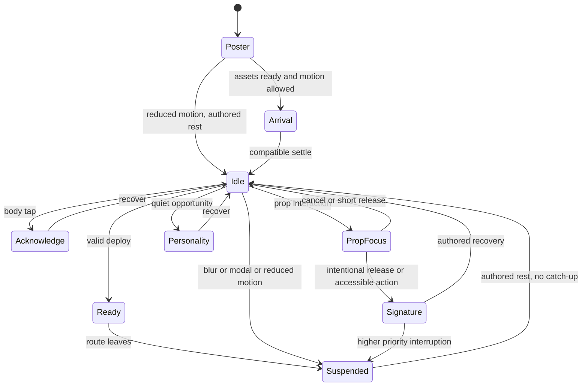

# Brain Brawlers - Home Brawler performance direction

Status: **Astral Sage's five-clip home pilot is implemented.**
The other five authored performances and physical-device acceptance remain open.

## Implementation checkpoint

- One new identity-matched painted puppet master supplies six head drawings,
  three forearm/hand drawings, an independent coat tail and a separate star.
  Sage no longer uses the single-image mesh idle in the Arena.
- Arrival, quiet blink/gaze idle, tap acknowledgement, focus/pinch/release/
  recovery and a nonblocking deployment-ready beat use authored timing.
- Tap Sage's upper body to acknowledge; tap or hold/release the star to interact.
  Leaving the hold target cancels into recovery. The constellation sigil is the
  accessible, non-hold equivalent. The nameplate and Brawlers destination retain
  roster access.
- One active canvas shares the existing atmosphere. Background, blur, mode
  inspection and reduced motion stop/park the actor without catching up missed
  clips. Reduced motion uses a baked rest pose and concise feedback.
- The ready cue never delays navigation; a fast route change can cut it short.
  Full Duel/VS transition work is still separate.
- Each head is trimmed to the skin neckline; its extra detached shirt collar
  is removed. A repainted neck bridge and a separate, stationary foreground
  collar seat the skin inside the torso. The head pivots at the anatomical neck
  root, not the bottom of the removed collar. The animated drawings and baked
  poster share this assembly. The earlier offset/layer-order-only fix was
  visually rejected and is superseded.
- The back-neck skin has a concealed overlap beneath the fixed collar. This
  closes the edge slit without sinking the face into the coat. Final socket:
  `(216, 172)`, with the approved horizontal placement unchanged.
- Texture errors expose an accessible alert and retry while preserving the
  static Brawler and navigation. No gameplay, save, loadout or reward writes
  accompany the acting.

Implementation: [player](../src/components/world/SagePerformance.tsx),
[timing/registration](../src/components/world/sage-performance.ts),
[source/atlas/poster builder](../scripts/build-sage-performance.py).
Rebuild with `python scripts\build-sage-performance.py`.

The atlas is 1536 x 1536 RGBA: **9 MiB decoded**, before graphics/cache overhead.
This is not a measured native memory/FPS acceptance result. No new renderer,
Spine dependency or license was introduced. These are layered painted poses,
not a freely turning 3D model or facial/lip-sync rig.

Verification: the initial pilot passed 11 affected suites / 169 tests. The final
neck follow-up passed four affected suites / 55 tests, including fixed back-edge
pixel coverage and socket bounds that reject the accumulated downward offsets.
Real CanvasKit checks all six drawings at three turn angles; the fixed
back-neck band has no alpha gaps below 250. The baked rest also closes the band.
Application/affected-test types and affected-file lint pass. The live Arena was
reloaded, its `(216, 172)` registration verified and its fetched atlas hash
matched to the local rebuilt PNG. Do not judge a disconnected, stale Metro
preview by screenshots alone.

The earlier pilot's production web/Android/iOS exports and isolated browser
hold/cancel, spam, save, reduction/navigation and 320/390/1366-wide layout checks
passed. Physical-phone QA remains pending.

The remaining sections preserve the broader direction; kit/result-specific
acting, full-body turns and the other five Brawlers are not claimed complete.

## 1. Animate the character, not the picture

The current home renderer is a useful ambient foundation: small painted-mesh
breathing, fixed feet, a rigid face and procedural prop accents. It does not
provide convincing acting, hand articulation, head turns or independent cloth.
Increasing deformation or adding particles is not the next quality leap.

The new direction:

**The Brawler notices you. Their hands have intent. Their prop has weight.
Their personality survives with every VFX layer switched off.**

Aim for mature, self-assured human performances: restrained, precise and
occasionally spectacular. Not a bouncing mascot, a pet to poke, a floating
portrait or a loop of arbitrary weapon flourishes.

Preserve the approved human faces, costumes, proportions and equipment.
Home, collection and combat must continue to feel like the same Brawlers.

## 2. The three home-screen Aha moments

### A. "They noticed me"

Tap the Brawler:

1. Immediate local touch acknowledgement, approximately 60-100 ms.
2. Eyes/head turn toward the point of interest using proper drawings/rigging.
3. A character-specific acknowledgement: a small nod, restrained smile,
   wrist adjustment or shield response.
4. A deliberate settle into the original readable stance.

Target: approximately 450-700 ms. It should feel like a person acknowledging
the player, not a spring applied to the whole image. No full-screen shake.

### B. "Their power responds to my hand"

Tap or optionally press-and-hold the character's existing prop/device:

- The Brawler first looks at the prop and changes grip.
- Fingers and wrist have authored poses; the object is not glued to a warped
  forearm texture.
- Holding builds physical tension or focused light, not a numeric buff meter.
- Release produces one controlled signature flourish, then returns to rest.
- Releasing early or leaving the target cancels naturally. There is no failure,
  currency cost, hidden reward, new ability or gameplay power-up.

The same flourish must have a simple accessible button alternative. Precision
touch and long holds are optional play, never the only way to use the screen.

### C. "They are ready to enter the fight"

After a valid Duel command:

- Attention shifts from the prop/player toward the arena.
- An authored stance change, hand preparation and clothing follow-through
  communicate readiness. A real step needs a real planted-foot pose.
- The game begins its actual acquisition/readiness flow immediately.
- The performance uses available presentation time; it does not add a mandatory
  cinematic delay or start the battle timer early.

Target: approximately 500-800 ms of actor performance, interruptible by
navigation/cancellation. This is a home acting beat, not approval to build the
entire later Duel/VS transition now.

## 3. Performance layers, not one repeating wobble

| Layer | Proposed performance | Trigger / restraint |
| --- | --- | --- |
| Arrival | From an authored thoughtful/resting pose into eye contact; prop resolves; coat settles | Once per session or a genuinely changed equipped Brawler, not every tab return |
| Base idle | Actual breathing, small eye changes, occasional blink, hand grip and asymmetric posture | Quiet 6-8 s base cycle with variation; no synchronized sine-wave body |
| Personality beat | A short, distinctive mini-scene with the Brawler's device | Sparse quiet-window opportunity, initially around 18-30 s; cancelled by useful input |
| Acknowledgement | A glance/nod/prop response toward the interaction | Tap; short cooldown avoids restarting a full performance on spam |
| Signature interaction | Focus -> grip change -> controlled prop flourish -> settle | Tap prop or optional hold/release; roughly 1-2.6 s |
| Kit awareness | Eyes/hand acknowledge the inspected or successfully fitted socket | Never imply equipment changed before a successful save |
| Match return | A restrained win acknowledgement or composed reset after defeat | Once for a real saved result; skip if the equipped Brawler no longer matches that match |
| Ready stance | A real change in demeanor before deployment | Only a valid Duel command; input/backend flow never waits for the clip |

These are timing directions, not measured current capabilities or a promise to
author every layer in the first implementation.

## 4. Six Brawlers, six different performances

Keep the identities from [the roster](../src/data/fighters.ts). These are
personality/VFX performances, not new passives, weapons or combat abilities.

| Brawler | Acting quality | Proposed signature | Touch response |
| --- | --- | --- | --- |
| Astral Sage | Economical, thoughtful, quietly confident | Looks at the star-data device, pinches it into a compact glyph, guides one constellation arc, then checks the player with a restrained knowing expression | Star focuses toward the touch; the hand follows with an authored grip change |
| Nightblade | Stillness followed by crisp precision | Checks a crescent bracer, turns the wrist into the light, shifts into alert eye contact; the crimson scarf settles after the body | One quick bracer/catchlight response and a controlled glance, not slapstick irritation |
| Thorn Ranger | Curious, relaxed asymmetry | Studies the botanical scanner; a leaf-shaped projection unfurls and is guided back into it | Scanner follows the point of interest; a small curious expression, no invented growth ability |
| Iron Bastion | Deliberate mass and reassuring control | Repositions the shield grip, lets the shield catch the light, then settles shoulders and stance | A shield tap produces a small authored give/return and energy ripple, not a fake block buff |
| Ember Sentinel | Contained confidence and energy | Passes the amber light pulse between hand poses, compresses it, then releases a small controlled flourish | Pulse answers the touch and settles back into the palm; no constant firestorm |
| Frost Warden | Measured, exact, analytical | Aligns the holographic wrist device, draws one clean symbolic figure and returns it to its original configuration | A holographic element follows within a constrained range, then resolves cleanly |

Avoid one generic animation with six colors. Head timing, pauses, body mass,
hand shapes and recovery should distinguish them before the effects are added.

## 5. Astral Sage pilot - one production-quality performance

Astral Sage is the recommended pilot because it is the default owned Brawler
and its star/hand/face interaction tests the hardest useful parts immediately.

### Signature shot: "Pinch the constellation"

| Time in a proposed 2.6 s clip | Acting / staging |
| --- | --- |
| 0-250 ms | Eyes lead toward the star; head follows slightly; hand prepares |
| 250-650 ms | Forearm brings the prop inward; fingers change from open to a believable pinch |
| 650-1050 ms | Star-data shape compresses into a precise glyph; readable pose hold |
| 1050-1350 ms | A controlled release/finger gesture leads the object's arc |
| 1350-1850 ms | One constellation unfurls within the stage; body stays grounded |
| 1850-2250 ms | Quick eye contact and a subtle knowing expression |
| 2250-2600 ms | Return to the neutral prop pose; coat follow-through settles last |

Do not make every quiet idle play this whole scene. It is an earned interaction
or sparse personality beat, not continuous spectacle.

### First pilot package

Prove five authored clips before expanding the roster:

1. Arrival/attention.
2. Quiet base idle.
3. Tap acknowledgement.
4. Prop-focus/signature/recovery sequence.
5. Ready-to-deploy stance.

Use explicit transition/park poses such as neutral, prop-focus and ready.
Interruptions must blend through compatible poses, not ghost two heads or
interpolate an incorrect grip through the object.

## 6. The art/animation pipeline must change

### Recommended first route: authored painted 2.5D performance

Use an animation-ready layered character with authored bones, actual key poses
and replacement drawings. Deformation can be a small supporting technique for
cloth; it must not be the source of the acting.

Required source work:

- A faithful, higher-resolution master of the approved Brawler identity.
- Separated front/back limbs, hands, torso, neck/head and relevant coat/scarf
  sections, with occluded areas repainted rather than exposed holes.
- Head/view drawings for neutral, player attention and prop attention, with
  appropriate in-betweens where a continuous turn is visible.
- Eyelids, brows and subtle expression variants appropriate to an adult human.
- Real open/pinch/point/rest hand drawings or a properly articulated hand rig.
- Prop/device separated from the body, with correct grip and foreground/
  background occlusion.
- Authored pose/timing curves, drawing swaps and draw-order changes.
- Foot contact and prop-grip markers; explicit safe transition poses.

This is not "cut the old PNG into pieces and stretch it harder." Significant
new views/poses need actual artwork. Do not independently regenerate dozens of
unrelated frames and accept drifting faces, costumes or hand anatomy.

Spine-style authoring supports attachment swaps and keyed draw order, but that
does not make it an installed/supported Expo/Skia runtime. Before adopting a tool,
verify editor/runtime licensing, supported rendering/export path and compatibility
with the current app. Do not promise a drop-in integration.

### When to choose a real 3D master instead

Use a properly modeled, textured, facially rigged 3D character if the required
performance includes free head/body turns, substantial camera orbit, reaching
toward the camera or complex foreshortened walks/grips.

That route needs real modeling, rigging, acting, painterly shading and mobile
integration work. It is not a conversion button for the existing portraits.
One approved master should drive consistent home/collection/battle outputs.
Do not introduce a shiny plastic 3D home character unrelated to the paintings.

If a 2.5D shot cannot meet the quality bar, redraw that shot or choose the 3D
master route before scaling to six characters. Do not compensate with more warp.

### Avoid as the default

- Whole-image scale/tilt used as acting.
- Facial features stretched from one fixed-angle drawing.
- A new generic vector body behind the approved portrait.
- Large full-body sprite stacks or alpha-video loops assumed cheap/portable
  without memory, quality and native compatibility testing.
- A new renderer/framework adopted before the character-performance proof.

## 7. A deliberate home interaction model

Today, tapping the large home Brawler opens the roster. To make the Brawler
interactive, change this intentionally, not accidentally:

- **Tap body:** acknowledgement.
- **Tap prop:** short personal response.
- **Optional hold/release prop:** signature flourish.
- **Nameplate/visible inspect sigil:** inspect the Brawler.
- **Existing Brawlers destination:** choose/equip a character as before.
- **Accessible Interact / Play signature actions:** equivalent non-gesture paths.

Keep all navigation reachable without a long hold. Stage gestures never silently
equip, change the loadout, spend resources or modify combat abilities.
Do not put a numerical charge/buff/cooldown meter on a cosmetic interaction.

Hit testing should use the current rig's projected prop/body regions; empty
background taps should not pretend to touch a hand. Existing menu/Duel targets
remain fixed and at least 48 px, even if the actor or camera moves.

### Interruption priority

1. Navigation, modal/error/recovery and accessibility changes.
2. Valid deployment.
3. Actual saved kit/result context.
4. Direct character interaction.
5. Arrival.
6. Sparse personality beat.
7. Base idle.

Useful input is never queued behind the actor. A repeated tap still gets quick
acknowledgement but does not restart a 2.6 s flourish ten times. Leaving a hold
zone or opening a menu cancels the gesture without an ability/reward event.

On blur/background, stop work and park at a meaningful authored pose. On return,
do not replay missed idle scenes or an old win reaction. Reduced motion uses a
settled authored pose and concise non-spatial acknowledgement.

The diagram is a presentation state machine only. It must not own navigation
success, persistence, battle deadlines or reward generation.

## 8. Camera, light and VFX support the acting

- Keep the base home camera composed and stable.
- A tiny, bounded focus push can accompany an entrance or signature beat,
  never ongoing reading/menu interaction. UI hitboxes do not move with it.
- Character, prop and cloth should have believable overlap before any VFX.
- Keep the existing atmosphere as a quiet background; do not make six effects
  compete with the actor's face.
- No full-screen white flashes, constant shake or giant text on every touch.
- Audio/haptics may reinforce the performance later, but are not required for
  the visual proof and remain separate opt-in scope.

## 9. Engineering/asset gates, not unmeasured promises

Before selecting the final player/runtime:

1. Prove one real animation-ready Sage rig with a head/view swap, believable hand
   grip, independent prop and correct draw order on web/Android/iOS.
2. Confirm interrupt/blend behavior without face ghosting or wardrobe seams.
3. Retain the current static portrait during legitimate loading. Surface asset
   errors explicitly with recovery; do not silently claim animation is playing.
4. Load the selected character first, keep one active character presentation,
   and release/stop inactive work. Do not allocate a canvas per facial feature.
5. Measure texture/decode memory, shader cost and input latency on reference
   phones before multiplying the content across six Brawlers.

For orientation only, one 2048-square RGBA atlas is 16 MiB uncompressed and one
1024-square atlas is 4 MiB, before mipmaps/other overhead. A roughly 20 MiB
active art-pack target is a useful starting discussion, not an accepted or
measured shipping budget. Artistic fidelity may require a different trade-off.

Author performance at an intentional cadence, with holds and real in-betweens;
render UI/input smoothly. A 60 Hz render loop does not turn weak key poses into
premium acting. Native-device measurement remains required.

## 10. Quality bar - remove the effects and it still works

- With smoke, glow, particles and sound disabled, the Brawler still reads as
  thinking, noticing, preparing and recovering.
- Eyes/head lead a purposeful action; hand/object contact stays convincing.
- The face remains the same person through alternate drawings and poses.
- Clothing follows the body with intentional delay instead of elastic stretching.
- Feet plant and transfer weight correctly; the shadow follows the contact,
  not a generic whole-body hover.
- Frame-by-frame inspection shows correct silhouettes and front/back occlusion.
- Touch has an immediate response, while long acting stays interruptible.
- Repeated taps, hold cancel, menu open, deploy, reduced motion and blur/resume
  produce natural state transitions, not snapped/broken intermediate anatomy.
- No changes to equipment, rewards, passives, timers or match rules.
- Review current-versus-new footage at actual phone size before expanding.

The pilot fails if its best selling point is a new particle system over the same
warped painting.

## 11. Proposed sequence

1. **Approve the performance/asset route and Sage acting sheet.**
2. **Produce Sage's animation-ready source, replacement drawings and key poses.**
3. **Author and review the five-clip pilot without distracting VFX.**
4. **Wire home interaction/state priority and restrained supporting effects.**
5. **Validate quality, memory/input behavior and native playback.**
6. **Author the other five Brawlers as distinct performances.**
7. Resume the later Duel/VS + draft roadmap once the home performer is convincing.

Steps 1-4 now have a working Sage pilot and web/native bundle proof. Physical
device review in step 5 and distinct authored packs for the other five remain.
The existing mesh idles remain active for those five, not for home Sage.

## 12. Focused references

These are craft references, not assets to copy or proof of a particular lobby
interaction. Video title/publisher metadata was checked 12 November 2026.

| Reference | What to study | Boundary |
| --- | --- | --- |
| [L'Accord - Chamber trailer](https://www.youtube.com/watch?v=FUoqAn5T4h4), official VALORANT channel | Restrained adult confidence, deliberate poses and hand/prop acting | Cinematic acting reference, not a claim that the clip demonstrates our home UI |
| [Lycaon - Wolfishly Charming](https://www.youtube.com/watch?v=8OqyvAXbgiQ), official Zenless Zone Zero channel | Distinct personality, performance rhythm and clean authored pose transitions | Character-demo reference, not lobby footage; our Brawlers remain adult humans, not animal/mascot redesigns |
| [Arcane S2 official opening](https://www.youtube.com/watch?v=4Po84baYfAA), Netflix Brasil | Silhouette, pose composition, light and intentional holds | Film craft reference; not a promise of Netflix-level acting from the current PNGs |
| [Spine slots/draw-order documentation](https://esotericsoftware.com/spine-slots) | Keyed attachment/drawing swaps and correct front/back ordering | Authoring concept, not a verified native integration |
| [Spine runtimes license](https://esotericsoftware.com/spine-runtimes-license) | Check licensing before adopting an authoring/runtime path | No license or dependency was acquired in this planning task |

The recommended lesson is performance design and proper source assets, not
copying franchise faces, costumes, weapons or animation clips.
